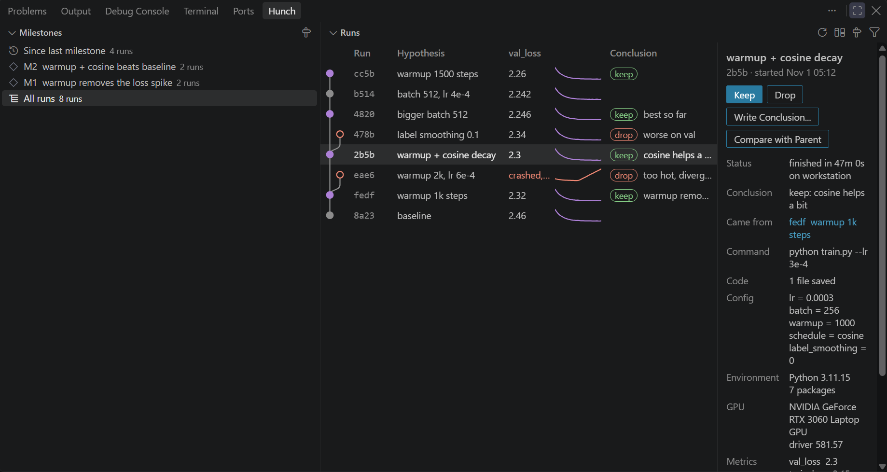

   
  

# Hunch for VS Code

**Every hunch, tracked. Now in VS Code.**

Your [Hunch](https://github.com/sigmoid-ide/hunch) runs in the bottom panel: what each run tried, how it went,
and what it showed.

- **The tree of runs**, with each run's hypothesis, main metric and its curve, and your conclusion. It updates while runs train.
- **Run with Hunch**: in the Run button's menu, runs the current Python file under Hunch, asking why first.
- **Keep or drop** a run and write its conclusion, from its details or a right-click.
- **Compare** a run with the one it came from, or any two runs: config, metrics and every changed file.
- **Milestones**: browse your runs milestone by milestone, and save one when you find something worth remembering.

Works in VS Code 1.85 or newer, Cursor, Windsurf and VSCodium, and over Remote SSH, WSL and Dev Containers.

## Get started

1. Install Hunch in your project's interpreter: `pip install sigmoid-hunch` (0.3.1 or newer).
2. Open the **Hunch** tab in the bottom panel (Ctrl+J, or Cmd+J on macOS).
3. Run a script with **Run Python File with Hunch** from the Run button's menu, or from a terminal:
   `hunch run -m "why" -- python train.py`.

## Settings

`hunch.interpreter`: the Python that has Hunch. When empty, the extension uses the interpreter selected in the
Python extension, then `python` on PATH.

## Privacy

No telemetry, no network. The extension reads `.hunch/` and appends your notes to it. It runs Python only for
Run with Hunch and Save Milestone, and only in trusted workspaces.

Apache-2.0 · Part of Sigmoid IDE · Like it? Give it a star.

